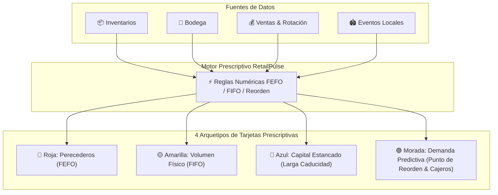

<<<<<<< HEAD
a
=======
# ⚡ RetailPulse - Dashboard de Analítica Prescriptiva Retail

<p align="center">
  
  
  
  
  
</p>

> **RetailPulse** es una plataforma web de analítica prescriptiva diseñada para transformar la gestión operativa de tiendas de conveniencia (tipo Oxxo). Reemplaza el análisis manual de gráficas complejas por **4 Tarjetas de Acción Prescriptivas** ejecutables en un solo clic.

---

## 📋 Tabla de Contenidos
- [🚨 La Problemática (El Dolor del Cliente)](#-la-problemática-el-dolor-del-cliente)
- [💡 La Solución (RetailPulse & 4 Arquetipos)](#-la-solución-retailpulse--4-arquetipos)
- [🔄 Diagrama de Arquitectura y Flujo](#-diagrama-de-arquitectura-y-flujo)
- [🎨 Características del Frontend UX/UI (4 Tarjetas)](#-características-del-frontend-uxui-4-tarjetas)
- [📁 Estructura del Repositorio](#-estructura-del-repositorio)
- [🛠️ Guía de Instalación y Ejecución Local](#️-guía-de-instalación-y-ejecución-local)
- [🔌 Contrato de Integración API REST](#-contrato-de-integración-api-rest)
- [🎤 Guía de Presentación / Pitch para Jueces](#-guía-de-presentación--pitch-para-jueces)

---

## 🚨 La Problemática (El Dolor del Cliente)

Las tiendas de conveniencia de alta densidad operan habitualmente de manera **reactiva y a ciegas**:

1. **Merma por Caducidad:** Se tiran miles de pesos a la basura semanalmente por no detectar comida perecedera a tiempo.
2. **Saturación Física de Bodega:** La bodega se abarrota de inventario de gran volumen, impidiendo la descarga del camión de reabastecimiento.
3. **Capital Financiero Estancado:** Productos de baja rotación (ej. licores premium) inmovilizan miles de pesos en flujo de caja durante meses.
4. **Falta de Predicción (Personal e Inventario):** Ante eventos masivos cercanos (ej. conciertos), la tienda sufre desabasto de cerveza/hielo y largas filas por falta de cajeros.

---

## 💡 La Solución (RetailPulse & 4 Arquetipos)

**RetailPulse** cambia el paradigma: **El gerente no analiza datos; el gerente solo decide y aprueba.**

El sistema genera **4 Arquetipos de Tarjetas Prescriptivas**:



---

## 🎨 Características del Frontend UX/UI (4 Tarjetas)

* **💎 Estilo Glassmorphism Dark Theme:** Fondo en tonalidad Slate (`#090D16`), tarjetas traslúcidas con efecto *backdrop-blur* y bordes de neón según el arquetipo.
* **🏬 Selector de Sucursales:** Cambio dinámico entre tiendas (*Sucursal Monterrey Norte*, *Sucursal Monterrey Sur*, *Sucursal Centro*).
* **💰 Tarjetas de KPIs en Tiempo Real:**
  - **Capital en Riesgo Proyectado ($ MXN)**
  - **Alertas Críticas Activas**
  - **Acciones Pendientes por Aprobar**
  - **Acciones Ejecutadas Exitosamente**
* **📋 Definición de los 4 Arquetipos Prescriptivos:**

| Color | Arquetipo | Lógica | Problema | Solución Prescriptiva |
| :---: | :--- | :--- | :--- | :--- |
| 🚨 | **Perecederos** | FEFO | Caduca en $< 3$ días (ej. sándwiches) | Descuento 40% hiperlocal en App Oxxo y remate |
| 🟡 | **Volumen Físico** | FIFO / Racks | Bodega $> 90\%$ llena (ej. botanas/sabritas) | Promoción 3x2 y mover empleado a bodega |
| 🔵 | **Larga Caducidad** | Capital Estancado | Lote lleva $> 40$ días sin rotación (ej. tequila) | Venta cruzada automática (15% desc. con hielos) |
| 🟣 | **Demanda Predictiva** | Reorden Dinámico | Concierto / Partido a 2km en 3 días | Sobresurtir cerveza (+50 cajas) y +2 cajeros extra |

* **✨ Animaciones y Notificaciones:**
  - Desaparición suave `fade/slide-out` al presionar `[ ✅ Aprobar Acción ]`.
  - Toast emergente confirmando la ejecución inmediata.
  - Pantalla de **Empty State** al completar todas las alertas.

---

## 📁 Estructura del Repositorio

```text
RoadToTech-HackProject/
├── Back-End/               # Motor de reglas numéricas y modelos de Ariel
│   ├── main.py             # FastAPI Server de Ariel
│   ├── mock_db.py          # Simulación de datos de inventario y bodega
│   └── motor_reglas.py     # Lógica determinista de alertas (FEFO/FIFO)
├── app.py                  # Servidor Flask (API REST + Servidor Web del Frontend)
├── templates/
│   └── index.html          # Interfaz de Usuario HTML5 Dashboard
├── static/
│   ├── css/
│   │   └── style.css       # Estilos Glassmorphism (4 Arquetipos) y responsive grid
│   └── js/
│       └── main.js         # Lógica interactiva cliente (Fetch API, Toasts, State)
├── requirements.txt        # Dependencias de Python (Flask, FastAPI, Pydantic)
└── README.md               # Documentación oficial del proyecto
```

---

## 🛠️ Guía de Instalación y Ejecución Local

### 1. Clonar el Repositorio
```bash
git clone https://github.com/Ariel-Hdz-Gar/RoadToTech-HackProject.git
cd RoadToTech-HackProject
```

### 2. Instalar Dependencias
```bash
pip install -r requirements.txt
```

### 3. Levantar el Servidor Web del Dashboard
```bash
python app.py
```
Abre tu navegador en: **`http://localhost:5000`**

---

## 🔌 Contrato de Integración API REST

| Ruta | Método | Descripción |
| :--- | :---: | :--- |
| `/api/alerts` | `GET` | Obtiene las alertas de los 4 arquetipos agrupadas por sucursal. |
| `/api/alerts/approve` | `POST` | Elimina la tarjeta aprobada y suma al contador de ejecuciones. |
| `/api/alerts/reset` | `POST` | Restablece las alertas iniciales para la demo. |

---

## 🎤 Guía de Presentación / Pitch para Jueces

1. **Abrir el Dashboard (`http://localhost:5000`):** Destaca las **4 Tarjetas de Colores** en *Sucursal Monterrey Norte*.
2. **Explicar los 4 Arquetipos:**
   - 🚨 **Roja:** Comida pudriéndose (FEFO).
   - 🟡 **Amarilla:** Espacio físico bloqueado en bodega (FIFO).
   - 🔵 **Azul:** Dinero estancado sin flujo (Capital inmovilizado).
   - 🟣 **Morada:** Oportunidad comercial y ajuste de personal por eventos.
3. **Ejecutar la Demo:** Da clic en `[ ✅ Aprobar Acción ]` en la tarjeta azul de Venta Cruzada. Muestra la animación de desvanecimiento, el Toast verde y el recálculo instantáneo del capital en riesgo.
4. **Reiniciar Demo:** Haz clic en **`Demo Reset`** en la esquina superior derecha para volver a comenzar.

---

<p align="center">
  <b>Desarrollado para RoadToTech Hackathon 🚀</b><br>
  <i>Ariel Hernández (Backend & Algoritmos) • Equipo RetailPulse (Frontend UX/UI)</i>
</p>
>>>>>>> d6d951056fdd9ed1cd958869619ac135abe47628
