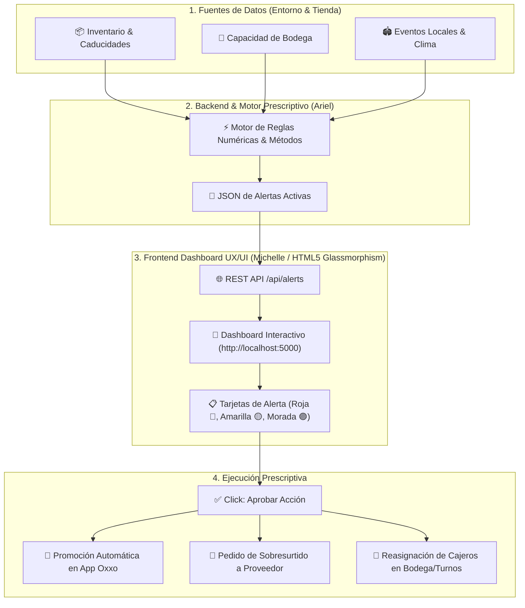

# ⚡ RetailPulse - Dashboard de Analítica Prescriptiva Retail

<p align="center">
  
  
  
  
  
</p>

> **RetailPulse** es una plataforma web de analítica prescriptiva diseñada para transformar la gestión operativa de tiendas de conveniencia (tipo Oxxo). Reemplaza el análisis manual de gráficas complejas por **Tarjetas de Acción Prescriptivas** ejecutables en un solo clic.

---

## 📋 Tabla de Contenidos
- [🚨 La Problemática (El Dolor del Cliente)](#-la-problemática-el-dolor-del-cliente)
- [💡 La Solución (RetailPulse)](#-la-solución-retailpulse)
- [🔄 Diagrama de Arquitectura y Flujo](#-diagrama-de-arquitectura-y-flujo)
- [🎨 Características del Frontend UX/UI](#-características-del-frontend-uxui)
- [📁 Estructura del Repositorio](#-estructura-del-repositorio)
- [🛠️ Guía de Instalación y Ejecución Local](#️-guía-de-instalación-y-ejecución-local)
- [🔌 Contrato de Integración API REST (Backend Interface)](#-contrato-de-integración-api-rest-backend-interface)
- [🎤 Guía de Presentación / Pitch para Jueces](#-guía-de-presentación--pitch-para-jueces)

---

## 🚨 La Problemática (El Dolor del Cliente)

Las tiendas de conveniencia de alta densidad operan habitualmente de manera **reactiva y a ciegas**:

1. **Merma por Caducidad:** Se tiran miles de pesos a la basura semanalmente porque el gerente no detecta la comida perecedera (ej. sándwiches, lácteos) hasta que ya vencieron.
2. **Saturación Física de Bodega:** La bodega se abarrota de inventario de baja rotación (ej. exceso de botanas), impidiendo físicamente la descarga del camión de reabastecimiento programado.
3. **Falta de Predicción (Personal e Inventario):** Ante eventos masivos cercanos (ej. conciertos, partidos de fútbol), la tienda sufre desabasto de productos clave (cerveza, hielo) y filas kilométricas por falta de cajeros en turnos pico.

---

## 💡 La Solución (RetailPulse)

**RetailPulse** cambia el paradigma: **El gerente no analiza datos; el gerente solo decide y aprueba.**

* El motor numérico y prescriptivo cruza el inventario interno con eventos del entorno.
* Genera **Tarjetas de Alerta Prescriptivas** digeridas con el riesgo financiero y la solución óptima recomendada.
* El gerente presiona **`[ ✅ Aprobar Acción ]`** y el sistema:
  - Lanza automáticamente el descuento o promoción en la App de lealtad.
  - Genera la orden de compra de sobresurtido al proveedor.
  - Notifica la reasignación de turno al personal.

---

## 🔄 Diagrama de Arquitectura y Flujo



---

## 🎨 Características del Frontend UX/UI

* **💎 Estilo Glassmorphism Dark Theme:** Diseñado con fondos en tonalidades Slate (`#090D16`), tarjetas traslúcidas con efecto *backdrop-blur* y acentos de luz neón.
* **🏬 Selector de Sucursales:** Cambio dinámico entre tiendas (*Sucursal Monterrey Norte*, *Sucursal Monterrey Sur*, *Sucursal Centro*).
* **💰 Tarjetas de KPIs en Tiempo Real:**
  - **Capital en Riesgo Proyectado ($ MXN)**
  - **Alertas Críticas Activas**
  - **Acciones Pendientes por Aprobar**
  - **Acciones Ejecutadas Exitosamente**
* **📋 Clasificación Visual de Tarjetas por Severidad:**

| Emoji | Categoría | Tipo de Problema | Acción Prescriptiva Típica |
| :---: | :--- | :--- | :--- |
| 🚨 | **Caducidad Inminente** | Sándwiches/Lácteos por vencer en < 48h | Lanzar descuento 40% flash en App Oxxo |
| 🟡 | **Saturación de Bodega** | Capacidad al 95% por botanas | Lanzar promo 3x2 y mover empleado a bodega |
| 🟣 | **Predicción de Evento** | Concierto masivo / Partido a 2km | Pedir +50 cajas de cerveza y +2 cajeros extra |

* **✨ Animaciones y Notificaciones:**
  - Animación de salida `fade/slide-out` al aprobar una tarjeta.
  - Toast emergente en tiempo real confirmando la acción ejecutada.
  - Pantalla de **Empty State** con mensaje de felicitación al dejar 0 alertas pendientes.

---

## 📁 Estructura del Repositorio

```text
RoadToTech-HackProject/
├── app.py                  # Servidor Flask (API REST + Servidor Web)
├── templates/
│   └── index.html          # Interfaz de Usuario HTML5 Dashboard
├── static/
│   ├── css/
│   │   └── style.css       # Estilos Glassmorphism, animaciones y responsive grid
│   └── js/
│       └── main.js         # Lógica interactiva en cliente (Fetch API, Toasts, State)
├── requirements.txt        # Dependencias de Python (Flask)
└── README.md               # Documentación oficial del proyecto
```

---

## 🛠️ Guía de Instalación y Ejecución Local

### 1. Clonar el Repositorio
```bash
git clone https://github.com/Ariel-Hdz-Gar/RoadToTech-HackProject.git
cd RoadToTech-HackProject
```

### 2. Crear y Activar Entorno Virtual (Recomendado)
**Windows (PowerShell):**
```powershell
python -m venv venv
.\venv\Scripts\Activate
```

**Linux / macOS:**
```bash
python3 -m venv venv
source venv/bin/activate
```

### 3. Instalar Dependencias
```bash
pip install -r requirements.txt
```

### 4. Levantar el Servidor Web
```bash
python app.py
```
Abre tu navegador en: **`http://localhost:5000`**

---

## 🔌 Contrato de Integración API REST (Backend Interface)

El backend expone los siguientes endpoints HTTP para interactuar con la interfaz gráfica:

### Endpoints REST

| Ruta | Método | Descripción | Payload Request | Respuesta |
| :--- | :---: | :--- | :--- | :--- |
| `/api/alerts` | `GET` | Obtiene la lista completa de alertas agrupadas por sucursal. | N/A | `{ "alerts": {...}, "executed_count": 0 }` |
| `/api/alerts/approve` | `POST` | Elimina la tarjeta aprobada y suma al contador de ejecuciones. | `{ "branch": "...", "alert_id": "ALT-001" }` | `{ "success": true, "alerts": {...} }` |
| `/api/alerts/reset` | `POST` | Restablece las alertas iniciales para la demo. | N/A | `{ "success": true }` |

### Estructura del JSON de Alertas (`dummy_data`)
```json
{
  "Sucursal Monterrey Norte 📍": [
    {
      "id": "ALT-001",
      "type": "red",
      "emoji": "🚨",
      "category": "Merma por Caducidad",
      "title": "Lote de 30 Sándwiches caduca en 2 días",
      "impact": "$2,100 MXN en Merma Directa",
      "recommendation": "Lanzar descuento 40% en App Oxxo y colocar etiqueta de remate en exhibidor.",
      "impact_value": 2100,
      "critical": true
    }
  ]
}
```

---

## 🎤 Guía de Presentación / Pitch para Jueces

1. **Abrir la Pantalla (`http://localhost:5000`):** Muestra el selector de sucursales en Monterrey Norte y destaca la estética de nivel producto comercial.
2. **Explicar el Valor Prescriptivo:** Señala los KPIs superiores (ej. *$21,600.00 MXN en Riesgo*). Enfatiza que el gerente **no pierde tiempo en análisis**, sino en la aprobación táctica.
3. **Demostración Interactiva:** 
   - Da clic en `[ ✅ Aprobar Acción ]` en la tarjeta de los Sándwiches (Roja).
   - Muestra cómo la tarjeta se desliza suavemente hacia afuera, sale el aviso verde en tiempo real y el dinero en riesgo baja automáticamente a *$19,500.00 MXN*.
4. **Demostración de Limpieza:** Elimina las 3 alertas para mostrar el estado de éxito total (*Empty State*). Usa el botón **`Demo Reset`** en la esquina superior derecha para volver a dejar todo listo para la siguiente ronda de preguntas.

---

<p align="center">
  <b>Desarrollado para RoadToTech Hackathon 🚀</b><br>
  <i>Ariel Hernández (Backend & Algoritmos) • Equipo RetailPulse (Frontend & UX/UI)</i>
</p>
